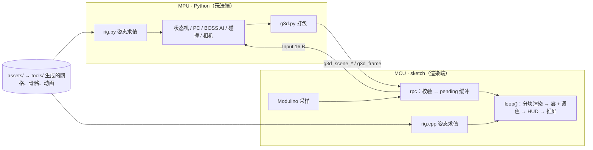

# g3d API v1

[文档索引](README.md) · [策划](plan.md) · [调研](research.md) · [分工](workflow.md)

这份文档是渲染端（MCU，sketch）和玩法端（MPU，Python）之间的**唯一契约**。修改 §2–§5 需要双方同意，并递增协议版本号 `G3D_VERSION`。

## 1. 总览与约定



| 约定 | 值 |
| --- | --- |
| 字节序 | 小端 |
| 世界单位 | 1 = 1 m。右手坐标系，+Y 向上；yaw = 0 时朝 +Z |
| 位置 | `i16`，单位 1/64 m，范围 ±512 m |
| 角度 | `u16` BAM（65536 = 360°）；`u8` / `i8` 为 BAM8（256 = 360°） |
| 颜色 | 场景参数用 RGB565 `u16`；物体着色用 `u8` 调色板索引（0 = 网格自带颜色），调色板见 §5.4 |
| 欧拉角顺序 | 先 yaw（Y），再 pitch（X），最后 roll（Z） |
| 单次 RPC 负载 | 二进制参数 ≤ **192 B** |
| 版本 | `G3D_VERSION = 1` |

## 2. Bridge RPC（sketch 提供，Python 调用）

| 方法 | 参数 | 返回 | 频率 | 说明 |
| --- | --- | --- | --- | --- |
| `g3d_hello` | `ver: int` | `bin` Caps（§3.4） | 启动时一次 | 版本不匹配时返回空 bin |
| `g3d_scene_begin` | `hdr: bin` | `bool` | 每局一次 | 清空场景，进入加载状态（画面显示 Loading） |
| `g3d_scene_chunk` | `kind: int, index: int, data: bin` | `bool` | 每局若干次 | 上传地形或岩石数据 |
| `g3d_scene_commit` | `crc16: int` | `bool` | 每局一次 | 校验 CRC 后构建地形网格；失败返回 false，Python 重新上传 |
| `g3d_frame` | `pkt: bin` | `bin` Input（§3.3） | **每帧一次** | 包无效或场景未提交时返回空 bin |
| `g3d_release` | — | `bool` | 退出时 | 交还显示权，回到 starter 等待画面 |

规则：

- **处理函数只做校验和拷贝，不做渲染。** 实现上用 `Bridge.provide` 注册（在 Bridge 线程里运行，Python 不用等渲染循环），共享数据用 `k_mutex` 保护。*（2026-10-24 改动，待 A 确认；原文为 `provide_safe`）*
- 同时保留原有的 `arcade_read_inputs` / `arcade_video_*`，RetroArch 流程仍然可用。
- MCU 超过 1.5 s 没收到 `g3d_frame` 时，显示 “Waiting…” 画面，但保留已加载的场景。
- 如果实测发现 `MsgPack::bin_t` 不能作为返回值，`g3d_frame` 改为返回 `String`（Input 的 16 字节编码成 32 个十六进制字符）。Python 端在 `unpack_input` 中兼容两种格式。**实测（2026-10-24）：`bin_t` 可以作为返回值**，Caps 的 bit0 为 1。

## 3. 二进制格式

### 3.1 Scene（`g3d_scene_begin` 的 `hdr`，≤192 B）

| 偏移 | 类型 | 字段 | 说明 |
| --- | --- | --- | --- |
| 0 | u8 | `ver` | 1 |
| 1 | u8 | `rig_id` | BOSS 骨骼 ID（0 = 无） |
| 2 | u16 | `sky_top` | RGB565 |
| 4 | u16 | `sky_horizon` | RGB565 |
| 6 | u16 | `fog_color` | RGB565，通常等于 `sky_horizon` |
| 8 | u8 | `fog_near` | 单位 2 m |
| 9 | u8 | `fog_far` | 单位 2 m，同时作为远裁剪面 |
| 10 | u8 | `terrain_n` | 每边顶点数，≤ 33（默认 17） |
| 11 | u8 | `terrain_cell` | 格宽（m） |
| 12 | i16×2 | `terrain_origin_x, _z` | 地形左下角位置，单位 1/64 m |
| 16 | u8 | `height_scale` | 高度单位，1/16 m |
| 17 | u8 | `n_rocks` | ≤ 64 |
| 18 | u16 | `grass_a` | RGB565 |
| 20 | u16 | `grass_b` | RGB565 |
| 22 | u8 | `light_yaw` | BAM8，平行光方向 |
| 23 | u8 | `light_pitch` | BAM8 |
| 24 | u8 | `n_slots` | ≤ 32，必须等于该骨骼定义的槽位数 |
| 25 | u8 × n | `slot_variant[]` | 每个槽位的变体编号（0 = 空），索引见骨骼定义 |

### 3.2 Scene chunks

| `kind` | 内容 | 每块格式 |
| --- | --- | --- |
| 1 地形 | 高度图，按行主序，`i8` × `terrain_n²` | 第 `index` 块从第 `index × 192` 个字节开始，每块 ≤192 B |
| 2 岩石 | 每块岩石 8 B：`x i16, z i16, yaw u8, scale u8 (1/16), variant u8, tint u8` | 每块 ≤24 个岩石，`index` 为块号 |
| 3 Look | 调色板 + 调色参数，格式见下表 | 只有 1 块，`index = 0`，76 B。**可省略**，省略时用 MCU 内置的默认 Look |

岩石的 y 坐标由地形高度求出，两端用同一个函数 `terrain_height(x, z)`（§6.3 / §7）计算，结果是双线性插值。

`g3d_scene_commit` 的 CRC 规则：CRC-16/CCITT-FALSE（初值 0xFFFF，多项式 0x1021），按 kind 升序、再按 index 升序，把所有 chunk 的 `data` 依次串接后计算。

**Look 块格式（kind 3，76 B）**。风格说明和预设见 [art.md §4](art.md#4-调色与滤镜look)。

| 偏移 | 类型 | 字段 | 说明 |
| --- | --- | --- | --- |
| 0 | u16 × 32 | `palette[]` | RGB565。索引 0 不使用，写 0 |
| 64 | u8 | `grade_mode` | 0 不调色，1 调色板级（commit 时处理颜色），2 逐像素（雾之后、HUD 之前）。Caps 不支持 2 时按 1 处理 |
| 65 | u8 | `saturation` | 128 = 原样，0 = 灰度，255 ≈ 2× |
| 66 | u8 | `contrast` | 128 = 1.0，以 50% 灰为中心 |
| 67 | i8 | `brightness` | 亮度偏移，单位 1/128 |
| 68 | u8 | `gamma` | 64 = 1.0 |
| 69 | u16 | `lift` | RGB565，叠加到暗部的偏色；0 = 不偏 |
| 71 | u16 | `gain` | RGB565，亮部乘色；0xFFFF = 不变 |
| 73 | u8 | `posterize` | 每通道保留的位数，0 = 不处理。仅模式 2 |
| 74 | u8 | `dither` | 0 关，1 Bayer 4×4。仅模式 2 |
| 75 | u8 | 保留 | 0 |

模式 1 下，调色同时作用于调色板和场景头里的 `sky_*`、`fog_color`、`grass_*`；模式 2 下这些颜色保持原样，统一在逐像素阶段处理，避免调两次。

### 3.3 Frame（`g3d_frame` 的 `pkt`，≤192 B）

**头部（24 B）**

| 偏移 | 类型 | 字段 | 说明 |
| --- | --- | --- | --- |
| 0 | u8 | `ver` | 1 |
| 1 | u8 | `seq` | 帧序号，回显在 Input 中 |
| 2 | u8 | `flags` | bit0 线框调试，bit1 关闭雾，bit2 隐藏 HUD，bit3 受击红闪，bit4 冻结画面（只重画 HUD），bit5 临时关闭调色（调试对比用） |
| 3 | u8 | `n_obj` | 0–12 |
| 4 | i16×3 | `cam_x, cam_y, cam_z` | |
| 10 | u16 | `cam_yaw` | |
| 12 | i16 | `cam_pitch` | |
| 14 | u8 | `fov` | 水平视野角（度） |
| 15 | u8 | `game_state` | 0 Ready，1 Fight，2 Win，3 Lose，4 Paused。决定 HUD 布局 |
| 16 | u8 | `hp` | |
| 17 | u8 | `hp_max` | ≤ 10 |
| 18 | u8 | `boss_hp` | 0–255，表示比例 |
| 19 | u8 | `msg_id` | 提示语编号（§3.5） |
| 20 | i8 | `reticle_dx` | 准星相对屏幕中心的偏移，单位 2 px |
| 21 | i8 | `reticle_dy` | |
| 22 | u8 | `reticle_flags` | bit0 指向部件，bit1 可挂钩 |
| 23 | u8 | `timer` | 秒 |

**Rig 块（偏移 24，16 B）**

| 偏移 | 类型 | 字段 |
| --- | --- | --- |
| 24 | u8 | `rig_id`（0 = 不画） |
| 25 | u8 | `anim_id` |
| 26 | u8 | `anim_phase`（0–255，表示一个动画周期内的位置） |
| 27 | u8 | `hit_slot`（被击中而闪烁的槽位，0xFF = 无） |
| 28 | i16×3 | `x, y, z`：rig 原点，即 BOSS 脚下的地面点；骨骼世界矩阵 = `T(x, y, z)·Ry(yaw)·W(bone)` *（待 A 确认）* |
| 34 | u16 | `yaw` |
| 36 | u32 | `part_alive`（bit i 表示槽位 i 未被击破） |

**Hook 块（偏移 40，8 B）**

| 偏移 | 类型 | 字段 |
| --- | --- | --- |
| 40 | u8 | `flags`：bit0 显示绳索，bit1 已挂住 |
| 41 | u8 | 保留 |
| 42 | i16×3 | `anchor_x, _y, _z`：绳索一端在 PC 的 `hand` 挂点，另一端在这里 |

**物体（偏移 48，每个 12 B，最多 12 个）**

| 偏移 | 类型 | 字段 |
| --- | --- | --- |
| 0 | u8 | `mesh_id`（§5.3，0xFF = 跳过） |
| 1 | u8 | `tint` |
| 2 | i16×3 | `x, y, z` |
| 8 | u16 | `yaw` |
| 10 | i8 | `pitch` |
| 11 | u8 | `scale`（1/16） |

包长必须严格等于 `48 + 12 × n_obj`。

### 3.4 Caps（`g3d_hello` 返回）

`ver u8, render_w u16, render_h u16, tile_h u8, max_obj u8, max_slots u8, n_mesh u8, n_rig u8, flags u8`，共 11 B。`flags` 的 bit0 表示支持返回 bin，bit1 表示支持逐像素调色（`grade_mode = 2`）。

### 3.5 Input（`g3d_frame` 返回，16 B）

| 偏移 | 类型 | 字段 |
| --- | --- | --- |
| 0 | u8 | `ver` = 1 |
| 1 | u8 | `seq_ack`：最近开始渲染的帧序号 |
| 2 | u8 | `connected`：bit0 Buttons，bit1 Joystick，bit2 Movement |
| 3 | u8 | `buttons`：bit0–3 是当前按住的 A、B、C、摇杆按下；**bit4–7 是“上一次回复以来新按下过”**（同样顺序），由 MCU 在两帧之间锁存，回复后清零，快速点按不会丢 *（待 A 确认）* |
| 4 | i8 | `jx`（原始值） |
| 5 | i8 | `jy` |
| 6 | i16×3 | `ax, ay, az`（mg，原始值，含重力） |
| 12 | i8 | `gx`（°/s ÷ 4），可选，未实现时为 0（视角由加速度算出） |
| 13 | i8 | `gy`，同上 |
| 14 | u8 | `render_ms` |
| 15 | u8 | `push_ms` |

**`msg_id` 表**（文字存在 MCU 端，`sketch/hud_text.h`）：0 无，1 “Press A to start”，2 “Break the armor”，3 “Hook on! (C)”，4 “Strike the head”，5 “Hold on!”，6 “Victory - C to restart”（被 13 取代），7 “Defeated - C to restart”（被 14 取代），8 “Controller missing”，9 菜单选中 Continue，10 菜单选中 Restart，11 菜单选中 Recalibrate（`game_state = 4` 时 HUD 画三项菜单并高亮该项），12 “Hold the console naturally, press A”，13 “Victory - A to restart”，14 “Defeated - A to restart”，15 “Stick move  Tilt look  B shoot  A menu”，16 “Waiting for Python”（仅 MCU 演示画面使用），17 “Break the crystals”。新增文案时追加编号，不要改已有编号。*（9–17 和 3 的按键文字为 2026-10-24 改动，跟随新的操作表，待 A 确认）*文案**只允许 ASCII 0x20–0x7E**，用像素字体绘制（[art.md §5](art.md#5-hud-与字体)），构建时检查。

## 4. 错误处理约定

| 情况 | MCU | Python |
| --- | --- | --- |
| 包长度、版本号或字段越界 | 整包丢弃，返回空 bin | 计数后丢弃；连续 10 次失败就重新执行 `hello` 和场景上传 |
| RPC 超时（0.5 s） | — | 跳过本帧，游戏逻辑按真实经过时间推进 |
| 1.5 s 无帧 | 显示 Waiting 画面，保留场景 | — |
| 控件断开（`connected` 缺位） | 照常上报 | 游戏进入 Paused，`msg_id = 8` |
| `video` 会话占用显示 | `g3d_frame` 返回空 bin | 等待 0.5 s 后重试 |
| 场景 CRC 不一致 | `commit` 返回 false | 重新上传，最多重试 3 次 |

## 5. 共享数据格式

全部放在 `assets/` 下，由 `tools/` 中的工具**生成两端代码**，生成的文件不手动修改。

### 5.1 骨骼与动画：`assets/rigs/<name>.json`

```json
{
  "id": 1, "name": "moose",
  "bones": [
    {"name": "root",  "parent": null,   "offset": [0, 6, 0],   "mesh": "moose_torso",
     "colliders": [{"type": "capsule", "a": [0, 0, -4], "b": [0, 0, 4], "r": 2.5, "hookable": true}]},
    {"name": "neck",  "parent": "root", "offset": [0, 1.5, 4], "mesh": "moose_neck",
     "colliders": [{"type": "sphere", "c": [0, 1, 1], "r": 1.2, "hookable": true}]}
  ],
  "attach": {"head_weak": {"bone": "head", "offset": [0, 0.8, 0.5]}},
  "slots": [
    {"bone": "neck", "offset": [0, 1.2, 1], "rot": [0, 0, 0],
     "variants": [null, "armor_plate_a", "crystal_a"],
     "collider": {"type": "sphere", "c": [0, 0, 0], "r": 0.9},
     "hp": 3, "tags": ["phase2"]}
  ],
  "anims": [
    {"id": 0, "name": "idle", "loop": true, "keys": 4,
     "tracks": {"neck": [[0, 0, 0], [5, 0, 0], [0, 0, 0], [-5, 0, 0]]},
     "root_y": [0, 0.1, 0, -0.1],
     "events": []},
    {"id": 2, "name": "punch_r", "loop": false, "keys": 6,
     "tracks": {"leg_fr": [[0,0,0], [-40,0,0], [-60,0,0], [30,0,0], [10,0,0], [0,0,0]]},
     "events": [{"phase": 128, "type": "hit", "bone": "leg_fr", "r": 3.0, "dmg": 1}]}
  ]
}
```

| 字段 | 规则 |
| --- | --- |
| `bones` | ≤ 16 个，父骨骼必须排在子骨骼之前；`offset` 为在父骨骼坐标系中的位置（m） |
| `colliders` | 只允许 `sphere` 和 `capsule`，坐标在骨骼局部坐标系中。`hookable` 表示钩锁能否挂上 |
| `slots` | ≤ 32 个；`variants[0]` 固定为 `null`（空）；`tags` 供玩法端判断阶段。部件网格朝 +Z（向外）、底面在 z = 0，`rot`（欧拉角，规则同 track）把它转到附着面上。同一位置可以放两个槽位（例如石盖 `cover` 和弱点 `weak`） |
| `anims` | ≤ 16 个。**线性插值**，欧拉角单位为度。没有 track 的骨骼保持静止姿态。关键帧在 phase 上的分布见下文 |
| `tracks` | 每根骨骼 `keys` 个三元组 `[rx, ry, rz]` |
| `root_y` | 可选，`keys` 个数值（m），加到根骨骼 `offset` 的 y 上，用于起伏、跪地、人立 |
| `events` | 只有玩法端使用，渲染端忽略。类型：`hit`（`bone`、`r`、`dmg`：该骨骼原点半径 `r` 内的 PC 受伤）、`shockwave`（`speed` m/s，从根骨骼正下方向外扩散）、`throw`（挂在 BOSS 上且没有脱离的 PC 被甩落，扣 `dmg`）、`cam_shake`（`amp` m）。新增类型时在这里登记 |

**姿态求值**（`rig.py` 和 `rig.cpp` 必须一致，以本节为准；本地预览工具 `arcade/tool/common.py` 的 `pose()` 按同样规则实现）：

- 旋转：三元组 `[rx, ry, rz]` 按 §1 的顺序先 yaw、再 pitch、最后 roll，即 `R = Ry(ry) · Rx(rx) · Rz(rz)`。腿沿 −Y 下垂，所以大腿 `rx < 0` 是向前抬。
- 骨骼世界矩阵：`W(bone) = W(parent) · T(offset) · R(track)`；根骨骼为 `T(offset + [0, root_y, 0]) · R(track)`。
- 关键帧位置：**循环动画**把 `keys` 个关键帧均匀铺在 phase 0–256 上，最后一帧插值回第一帧，即 `f = phase · keys / 256`；**非循环动画**首尾帧落在 0 和 255，即 `f = phase · (keys − 1) / 255`。取 `i = ⌊f⌋`、`t = f − i`，在第 i 帧和第 i+1 帧之间插值。
- 槽位部件的世界矩阵：`W(slot.bone) · T(slot.offset) · R(slot.rot)`。

`tools/rig_build.py` 的输出：

| 输出 | 使用方 |
| --- | --- |
| `sketch/gen/rig_<name>.h` | 渲染端：骨骼、槽位、动画关键帧（`const` 数组） |
| `python/gen/rig_<name>.py` | 玩法端：同样的数据加上碰撞体和事件 |
| `tests/golden/rig_<name>.json` | 双方：每个动画在 phase 0/64/128/192 时各骨骼的世界坐标原点。**两端实现的误差必须 ≤ 1 cm** |

### 5.2 网格：`assets/meshes/*.obj`

- 用 OBJ 格式，每个面的颜色取自材质的 `Kd` 值。导入时用 TGX 的 `tools/tgx_mesh.py` 转成 `Mesh3D<RGB565>` 头文件，`tools/mesh_build.py` 负责批量调用它并生成索引表。
- `Kd` 必须是默认调色板（§5.4）里的颜色，否则构建失败。`mesh_build.py` 为每个网格额外生成一张"子网格 → 调色板索引"表。渲染时逐个子网格调用 `setMaterialColor(palette[idx])` + `drawMesh(m, false, false)`，所以**换调色板不需要重新生成网格**。
- 建模规范（枢轴点、命名、面数）见 [art.md §8](art.md#8-建模规范)。
- 在模型交付前，`tools/mesh_build.py --placeholder` 会生成方块、胶囊体、多面体等占位模型，两端的开发都不需要等模型。

### 5.3 网格 ID 表：`assets/meshes.json`

由工具生成到 `sketch/gen/mesh_ids.h` 和 `python/gen/mesh_ids.py`。固定编号如下：

| ID | 网格 | | ID | 网格 |
| --- | --- | --- | --- | --- |
| 0 | `pc` | | 4 | `spark` |
| 1 | `bullet` | | 5 | `shockwave_ring` |
| 2 | `boss_shot` | | 6–15 | 保留 |
| 3 | `hook_head` | | 16+ | 骨骼段、部件、岩石（自动分配） |

PC 网格必须定义 `hand` 挂点（绳索起点），坐标写在 `assets/meshes.json` 中。文件格式：`{"meshes": [{"id": 0, "name": "pc", "tris": 60, "attach": {"hand": [x, y, z]}}, ...]}`，`tris` 仅供参考。

### 5.4 调色板与 Look：`assets/palette.json`、`assets/looks/<name>.json`

- `assets/palette.json`：32 色默认调色板，带名称，值见 [art.md §3](art.md#3-调色板)。生成到 `sketch/gen/palette.h`（MCU 内置默认 Look）和 `python/gen/palette.py`（名称 → 索引常量，玩法端设置 `tint` 时使用）。
- `assets/looks/<name>.json`：一个预设，包含 §3.2 Look 块的调色参数、可选的 `palette`（按名称覆盖其中几色，值为 `#rrggbb`）和可选的 `scene`（覆盖 `palette.json` 里 `scene_defaults` 的天空、雾、光照字段）。`world.py` 选好预设后，调色参数和调色板打包成 kind 3 chunk 上传，`scene` 写进场景头（§3.1）。
- 调色公式见 [art.md §4](art.md#4-调色与滤镜look)。
- **调色板索引的含义固定**（例如 9 永远是 `SIGIL`），Look 只改颜色值，不改用途。

### 5.5 字体：`assets/fonts/`

像素字体源文件（TTF 或 BDF）。`tools/font_build.py` 调用 Adafruit `fontconvert`，只保留 ASCII 0x20–0x7E，生成 `sketch/gen/font_small.h`（5×7）和 `sketch/gen/font_large.h`（8×8），格式为 TGX 支持的 `GFXfont`。

## 6. 渲染端模块（C++，`sketch/`）

```cpp
// tft8080.h：BSRR 快速写像素，初始化序列复用 DIYables 的 begin()
namespace tft {
void begin();
void window(int x0, int y0, int x1, int y1);
void pushPixels(const uint16_t* px, size_t n);
void pushRow2x(const uint16_t* row, int w);   // 横向 2× 放大写一行，调用方负责写两遍
void fill(uint16_t color, size_t n);
}

// scene.h：场景数据与地形网格
namespace scene {
bool begin(const uint8_t* hdr, size_t n);
bool chunk(uint8_t kind, uint8_t index, const uint8_t* data, size_t n);
bool commit(uint16_t crc);
float terrainHeight(float x, float z);          // 与 Python 版保持一致（§7）
}

// rig.h
namespace rig {
void pose(uint8_t rig_id, uint8_t anim, uint8_t phase, tgx::fMat4 out[]);   // 输出各骨骼的世界矩阵（根节点在原点）
}

// render.h
namespace render {
void begin();                                   // TGX Renderer3D<RGB565, PERSPECTIVE|ZBUFFER|FLAT|GOURAUD, uint16_t>
void frame(const FramePacket& f);               // 按 240×32 分块：天空 → 地形 → 岩石 → BOSS → 物体 → 绳索 → 雾 + 调色 → HUD → pushRow2x
}

// rpc.h
namespace rpc {
void begin();                                   // 注册 §2 中的方法
bool takePending(FramePacket& out);             // loop() 每次取最新的一帧
}
```

渲染要点：

- **分块渲染**：渲染分辨率 240×160，每块 240×32，颜色缓冲和 z-buffer 各 15 KB，共 5 块（实测比 240×16 少一半重复的三角形设置）。每块之前先按物体包围球在屏幕上的 Y 范围做剔除，避免每块都重新变换全部网格。
- **雾**：一块渲染完后逐像素读取 z-buffer，用 16 级查找表把颜色混向 `fog_color`；超过 `fog_far` 的部分直接画成雾色。
- **调色**：模式 1 在 `scene::commit` 里处理一次颜色，渲染时零开销。模式 2 在雾的同一个循环里接着做：查 R/G/B 三张通道表（32/64/32 项，commit 时预计算）+ 饱和度混合 + 可选 Bayer 抖动。HUD 在调色之后画，不受影响。
- **HUD**：在每块内绘制落在该块范围里的部分，不额外推屏，也就不会闪烁。字体只用 `sketch/gen/font_*.h`，不抗锯齿。
- **演示模式**：超过 1.5 s 没收到 `g3d_frame`（或收到 `g3d_release`）时，sketch 自动渲染内置演示：相机绕场地中心转圈，画面显示 `msg_id` 16 “WAITING FOR PYTHON”，不需要 Python 就能运行。以后 BOSS 加入后改为绕 BOSS 转圈并循环播放动画。

## 7. 玩法端模块（Python，`python/`）

```python
# g3d.py：协议层（纯函数，可在电脑上单元测试）
pack_scene(scene: SceneDef) -> tuple[bytes, list[tuple[int, int, bytes]], int]   # 返回 hdr、chunks、crc
pack_frame(seq: int, cam: Camera, rig: RigState | None, hook: HookState | None,
           objs: list[Obj], hud: Hud, flags: int = 0) -> bytes
unpack_input(data: bytes | str) -> RawInput | None

class G3D:                                       # 连接层
    def __init__(self, bridge, timeout: float = 0.5): ...
    def hello(self) -> dict: ...
    def load_scene(self, scene: SceneDef) -> None: ...      # begin + chunks + commit，带重试
    def frame(self, *args, **kw) -> RawInput | None: ...
    def release(self) -> None: ...

# controls.py：校准与边沿检测，沿用 preview.py 的参数
class Controls:
    def update(self, raw: RawInput, dt: float) -> Input: ...
    # Input.move: (x, y) ∈ [-1, 1]²，aim: (dx, dy)，pressed / held / released 位掩码

# world.py
def make_scene(seed: int) -> SceneDef: ...       # 高度图、岩石、部件随机组合
def terrain_height(scene: SceneDef, x: float, z: float) -> float: ...

# rig.py
def pose(rig, anim: int, phase: int) -> list[Mat4]: ...
def colliders_world(rig, poses, root: Transform, alive: int) -> list[Collider]: ...

# collide.py
def ray_cast(origin, dir, colliders, max_dist) -> Hit | None: ...  # Hit 包含 bone、slot、point、local_point
def sphere_vs(collider, center, r) -> bool: ...

# player.py / boss.py / camera.py / game.py
class Player:  def update(self, inp: Input, world, boss, dt): ...    # 移动、闪避、射击、钩锁
class Boss:    def update(self, player, dt): ...                     # AI 状态机、动画 phase、部件血量
class Camera:  def update(self, player, boss, inp, dt) -> CameraState: ...
class Game:    def step(self, inp: Input, dt: float) -> FrameArgs: ...  # Ready → Fight → Win/Lose
```

`terrain_height` 与 C++ 版必须采用相同的双线性插值规则：先把坐标换算成格坐标，再按 4 个角点高度插值；超出地形范围时取边缘值。

## 8. 上限汇总

| 项目 | 上限 | 依据 |
| --- | --- | --- |
| 每帧物体数 | 12 | 192 B 包长 |
| 骨骼段数 | 16 | rig 姿态计算开销 |
| 槽位数 | 32 | `part_alive` 为 u32 |
| 动画数 | 16 | |
| 地形顶点数 | 33 × 33（默认 17 × 17） | 三角面预算 |
| 岩石数 | 64 | |
| 调色板 | 32 色 | Look 块 76 B |
| 每帧三角面数 | 目标 ≤ 1500 | M0 实测后修正 |
| 帧率 | 目标 15–20 fps | research §5 |
