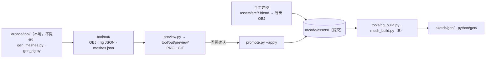

# 巨构游戏：美术规范

[文档索引](README.md) · [策划](plan.md) · [API](api.md)

## 1. 风格方向：致敬《旺达与巨像》

**只借鉴气质，不使用原作的任何素材、名称或标志性造型。** 素材来源在阶段 5 要写进文档。

| 支柱 | 含义 | 在本项目中的做法 |
| --- | --- | --- |
| 渺小与巨大 | 人站在山一样的生物脚下 | 骑手身高 1.7 m（骑在马上约 2.7 m），麋鹿肩高约 9 m、连鹿角约 13 m；相机低机位、上仰；PC 永远是画面里最小的东西 |
| 空旷、褪色、过曝 | 天地发白，颜色像被阳光晒褪 | 低饱和调色板，地平线接近白色，雾浓且亮；滤镜默认降饱和、提亮部（§4） |
| 活着的废墟 | 巨像是长着毛的古代建筑 | 深色皮毛身体 + 浅色石质护甲板 + 发光符印，三种材质一眼可分 |
| 安静与重量 | 动作慢、重、有预兆 | 动画大幅前摇、落地后有停顿（§7） |

### 视觉语言（玩法可读性的核心）

玩家只靠**材质颜色**就能知道该干什么，三类东西不准混色：

| 外观 | 玩法含义 | 调色板 |
| --- | --- | --- |
| 浅色、锯齿边的**毛丛** | 可挂钩（`hookable` 碰撞体只放在毛丛上） | `FUR_LIGHT` |
| 浅灰米色的**石板** | 护甲部件，可击碎 | `STONE_*`、`MOSS` |
| 青白色**发光符印** | 结晶 / 弱点 | `SIGIL`、`SIGIL_DIM` |
| 深棕**皮毛** | 普通身体，打了没用 | `FUR_DARK`、`FUR_MID` |

## 2. 角色与场景

### 巨型麋鹿（P0）

初版已经由 `arcade/tool/` 程序化生成（§9），下面是它遵循的设计。

- **轮廓**：肩峰高、臀部低，背线向后倾斜；腿长而细，蹄子是深色石头。正面看最大的识别点是**一对宽大的石质掌状鹿角**，角面朝前，从下往上看也能看出形状。
- **骨骼（11 段）**：`root`（躯干）、`neck`、`head`、`leg_fl/fr/bl/br`（大腿）、`shin_fl/fr/bl/br`（小腿 + 蹄）。四条小腿共用一个网格，前后大腿各一个。
- **石质护甲**：四条大腿正面各有一个护甲槽（护腿石板，两种变体），对应第 1 阶段"击碎腿部护甲 → 跪地"。背部槽是一段断裂的柱廊（三根断柱 + 底板），或者换成结晶。
- **符印**：颈部和背部的结晶是嵌在石座里的发光棱柱；眼睛是两块发光面片；头顶是弱点 `head_weak`，一块六边形符印，**暴露前被 `head_cap` 石盖住**。石盖和符印是同一位置的两个槽位（`tags` 分别为 `cover` 和 `weak`），玩法端在第 2 阶段结束时把石盖设为已击破。
- **毛丛**：肩峰、颈部鬃毛、臀部，都用三棱锥簇表现，颜色 `FUR_LIGHT`，和 `hookable` 碰撞体一一对应。腹部的垂毛用深色，不可挂钩。
- **面数**：身体 341 面（预算 600），部件每个 ≤40。剩余预算留给后续细化。

### 巨型猩猩（P2）

同样的材质语言：前臂护腕石板、背部断墙、石面具和发光眼洞，肩背的毛丛可挂钩，指关节着地。

### PC：骑手 + 马

PC 一直骑在马上，画成两个 rig：马（rig 3）和骑手（rig 4），骑手的根骨骼挂在马的 `saddle` 挂点上。

- **骑手**（≤90 面，9 段骨骼）：浅色短袍，深色短披风只盖肩膀，**红色腰带**和马背上的**红色鞍褥**是全画面仅有的暖色高饱和点，从背后也找得到自己。右前臂装钩锁发射器，兼作枪，发射器口是 `hand` 挂点。
- **马**（≤150 面，12 段骨骼）：深棕色身体、深色鬃毛和尾巴，石色蹄子。
- **钩锁时离鞍**：骑手被拉走后，马继续往前跑并在 0.45 s 内淡出到雾里；挂住时骑手蹲伏在 BOSS 背上的挂点（`cling` / `cling_shoot`）；松手下落时，马在落点前 0.4 s 淡入，骑手直接落回马鞍（`land_ride`）。PC 从不步行。被撞飞走同一条路线。
- **处刑（`execute`）**：BOSS 跪地、弱点暴露、PC 挂在背上时使用。从 `cling` 起跳落到头上，双手长时间蓄力，把钩爪砸进弱点，拧两下，拔出后站起举手。玩法端在第 0–3 键把根骨骼从挂点移到头上，从砸中（第 8 键）到弱点碎裂（第 11 键）放慢到 0.25 倍速，砸中时定格 0.12 s；两个 `sparks` 事件从 `hand` 迸出圆形发光粒子（白芯 + `SIGIL` 光晕，不受光照）。节奏参数在 `tool/gen_rider.py` 的 `EXEC`，预览 `tool/preview_execute.py`。
- **角色灯**：马和骑手用一盏跟随相机的方向光，第三人称看背面也不会发黑（api.md §3.3）。
- 0 号 `pc` 单体网格（59 面）只作备用。

### 场景

- **地面**：开阔、起伏平缓的草原，两种灰绿色交错（`GRASS_A/B`），偶尔露出土色。
- **岩石**：3 种变体，其中至少一种是**断柱或拱门残片**（≤30 面），用来营造废墟感，成本和普通岩石一样。
- **天空**：天顶淡灰蓝，地平线接近白色；雾色和地平线一致，远处的巨像只剩轮廓。
- **光**：太阳高且偏侧（`light_pitch` 约 50°），平面着色下的明暗面要分得开。

## 3. 调色板

32 色，索引 0 保留（表示不着色 / 用默认色）。这是**默认 Look**"Forbidden Plain"，运行时可以整体替换（[api.md §3.2 kind 3](api.md#32-scene-chunks)）。建模时 OBJ 的 `Kd` 只能用这张表里的颜色，`tools/mesh_build.py` 会把颜色映射为索引，不在表里的颜色会报错。

| # | 名称 | RGB888 | RGB565 | 用途 |
| --- | --- | --- | --- | --- |
| 1 | `FUR_DARK` | `#3b3430` | `0x39A6` | 巨像身体主色 |
| 2 | `FUR_MID` | `#574c43` | `0x5268` | 身体亮面 / 过渡 |
| 3 | `FUR_LIGHT` | `#7a6a58` | `0x7B4B` | 可挂钩毛丛 |
| 4 | `MASK` | `#4a4844` | `0x4A48` | 面具、手脚等深石色 |
| 5 | `STONE_LIGHT` | `#b8b2a2` | `0xBD94` | 护甲石板亮面 |
| 6 | `STONE_MID` | `#8e887a` | `0x8C4F` | 护甲石板 |
| 7 | `STONE_DARK` | `#625e55` | `0x62EA` | 石板侧面、刻纹 |
| 8 | `MOSS` | `#6f7556` | `0x6BAA` | 石板上的苔藓 |
| 9 | `SIGIL` | `#8fe3ff` | `0x8F1F` | 符印 / 结晶 / 弱点发光 |
| 10 | `SIGIL_DIM` | `#4a8fb0` | `0x4C76` | 符印暗部、未激活 |
| 11 | `PC_TUNIC` | `#d9d2bf` | `0xDE97` | PC 短袍 |
| 12 | `PC_CLOAK` | `#2e2a28` | `0x2945` | PC 斗篷、头发 |
| 13 | `PC_ACCENT` | `#b04a32` | `0xB246` | PC 腰带（唯一暖色点） |
| 14 | `PC_SKIN` | `#c49a7c` | `0xC4CF` | PC 皮肤 |
| 15 | `METAL` | `#9a9488` | `0x9CB1` | 武器 |
| 16 | `GRASS_A` | `#7c8460` | `0x7C2C` | 草地 A（默认 `grass_a`） |
| 17 | `GRASS_B` | `#8f9468` | `0x8CAD` | 草地 B（默认 `grass_b`） |
| 18 | `DIRT` | `#8a7d66` | `0x8BEC` | 裸土 |
| 19 | `ROCK_A` | `#a09a8c` | `0xA4D1` | 岩石、断柱亮面 |
| 20 | `ROCK_B` | `#7d786e` | `0x7BCD` | 岩石暗面 |
| 21 | `ROPE` | `#a89270` | `0xAC8E` | 绳索 |
| 22 | `HOOK` | `#6a6a6a` | `0x6B4D` | 钩爪 |
| 23 | `BULLET` | `#fff2c8` | `0xFF99` | 弹丸 |
| 24 | `SPARK` | `#ffd890` | `0xFED2` | 火花、碎屑 |
| 25 | `DUST` | `#d0c3a6` | `0xD614` | 冲击波尘环 |
| 26 | `FLASH` | `#ffffff` | `0xFFFF` | 部件受击闪烁 |
| 27 | `HURT` | `#c03a2a` | `0xC1C5` | PC 受击红闪、血格空 |
| 28 | `HUD_TEXT` | `#f0ece0` | `0xF77C` | HUD 文字、血格满 |
| 29 | `HUD_SHADOW` | `#1a1816` | `0x18C2` | 文字阴影、描边 |
| 30 | `HUD_BAR` | `#c8b48a` | `0xCDB1` | BOSS 血条 |
| 31 | `HOOK_OK` | `#ffe080` | `0xFF10` | 可挂钩准星 |

场景头的默认值：`sky_top = 0x9D56`（`#9aa8b0`），`sky_horizon = 0xDED9`（`#dcd8c8`），`fog_color = 0xCE57`（`#cfcbbd`），`fog_near = 20`（40 m），`fog_far = 60`（120 m），`light_yaw = 40`，`light_pitch = 36`。

## 4. 调色与滤镜（Look）

同一套模型，换 Look 就能换气氛。Look 由两部分组成，随场景通过 kind 3 chunk 上传（格式见 [api.md §3.2](api.md#32-scene-chunks)）：

1. **调色板**：上面的 32 色可以整体替换。
2. **调色参数**：饱和度、对比度、gamma、暗部偏色（lift）、亮部乘色（gain）、色阶、抖动。

**参考公式**（各通道取 0–1，MCU 和预览工具都按它实现）：

1. 饱和度：`c = Y + (c − Y) · saturation/128`，其中 `Y = 0.299R + 0.587G + 0.114B`
2. 对比度和亮度：`c = (c − 0.5) · contrast/128 + 0.5 + brightness/128`，然后截断到 0–1
3. gamma：`c = c ^ (64/gamma)`
4. 偏色：`c = lift + c · (gain − lift)`

Look 文件里的 `scene` 字段可以覆盖场景头的天空、雾、光照参数，由 `world.py` 写进场景头，不进入 Look 块。

**贴地雾**（`ground_fog`，Look 块第 75 字节）：普通的距离雾只看深度，26 m 外的 BOSS 完全不受影响，像贴在画面上。贴地雾按世界高度叠加：地面最浓、9 m 以上消失，并随深度在 30 m 内加满。效果是 BOSS 的腿沉进雾里、鹿角和上半身保持深色剪影，这是巨像的关键画面感。各预设：正午 120、黄昏 150、月夜 170、清晨 210（晨雾最重）。正午的距离雾也从 40 m 提前到 16 m，让 BOSS 带一点空气透视。MCU 按地形顶点和每个网格的中心计算贴地雾（不逐像素），几乎不增加耗时；所以 BOSS 是按骨骼分段变淡，小腿最浓、大腿次之、身体几乎不受影响。

调色有两种执行方式，用 `grade_mode` 选择：

| 模式 | 做法 | 开销 | 能做什么 |
| --- | --- | --- | --- |
| **1 调色板级**（P0 默认） | `scene_commit` 时把调色参数作用到 32 色和天空、雾、草地颜色上，渲染时直接用处理后的颜色 | 零逐像素开销 | 饱和度、对比度、偏色。光照明暗是在调色后的颜色上算的，效果接近 |
| **2 逐像素**（P1） | 在雾的那一遍循环里，雾混合后接着做一次调色 | 估算 3–6 ms/帧，M0 实测 | 以上全部，外加色阶（posterize）和 4×4 Bayer 抖动（PS1 质感） |

逐像素模式的实现：`commit` 时把参数预计算成 3 张通道查找表（R 32 项、G 64 项、B 32 项）加一个饱和度系数；每个像素做"解包 → 按亮度去饱和 → 查表 → 可选抖动 → 打包"。**HUD 在调色之后画，不受滤镜影响**，始终清晰。帧包 `flags.bit5` 可以临时关闭调色，方便对比调试。

### 预设

| 预设 | 气氛 | 主要参数 |
| --- | --- | --- |
| `forbidden_plain`（默认） | 正午、褪色、过曝 | 饱和度 0.7，亮部提亮，gain 略偏暖 |
| `dusk` | 黄昏、金色 | 饱和度 0.85，gain 偏橙，lift 偏紫，雾色换成暖灰 |
| `storm` | 阴天、冷峻 | 饱和度 0.45，对比度 1.2，gain 偏青，雾更近 |
| `dawn` | 清晨 | 东方低角度阳光（`light_pitch` 约 20°），冷色暗部、粉色高光，雾较近 |
| `night` | 月夜 | 饱和度 0.4，整体压暗偏蓝，雾最近（90 m）；调色板覆盖 `SIGIL` 让符印更亮 |
| `ps1` | 复古 | 在 `forbidden_plain` 基础上每通道 5 bit 色阶 + Bayer 抖动（需要模式 2，MCU 暂未实现，目前按模式 1 显示） |

所有预设的天空色调都已确认可用。**昼夜循环**：`world.TIME_OF_DAY` = 正午 `forbidden_plain` → 黄昏 `dusk` → 月夜 `night` → 清晨 `dawn` → 正午，每段停留 `DAY_HOLD`、再用 `DAY_BLEND` 平滑过渡到下一段（颜色、雾距、太阳方向和调色参数都插值），通过 `g3d_scene_sky` 发给 MCU（api.md §3.6）。目前是测试值 12 s + 8 s，一天 80 s。`storm` 和 `ps1` 不在循环里。预设放在 `assets/looks/<name>.json`，由 `world.py` 打包上传；MCU 内置一份 `forbidden_plain` 作为没有收到 Look 时的默认值。

## 5. HUD 与字体

- **只用英文，只用 ASCII 0x20–0x7E。** `sketch/hud_text.h` 和字体生成工具都会检查，出现非 ASCII 字符就构建失败。
- **像素字体，不抗锯齿。** 用 Adafruit GFX 字体格式（TGX 原生支持 `GFXfont`），在 240×160 的渲染分辨率上绘制，推屏时 2× 放大，像素边缘保持锐利。

| 用途 | 规格 | 候选（需开源许可） |
| --- | --- | --- |
| HUD 正文、提示语 | 5×7 字形，行高 8 px | Adafruit GFX 自带字体、Tom Thumb 的放大版等 |
| 标题、结算大字 | 8×8 字形，全大写，可再 2× 绘制 | Press Start 2P（OFL） |

- 字体源文件放 `assets/fonts/`，由 `tools/font_build.py`（调用 Adafruit `fontconvert`，只保留 ASCII）生成到 `sketch/gen/font_*.h`。
- 背景很亮，所有文字都带 1 px `HUD_SHADOW` 投影。
- **风格克制**：UI 少而小，贴边放；提示语全大写、居中偏下，例如 `BREAK THE ARMOR`。
- **准星**：普通是小十字（`HUD_TEXT`）；指向部件时四角收拢（`SIGIL`）；可挂钩时变成菱形（`HOOK_OK`）。三种状态靠形状加颜色区分。
- **血格**：小方块，满格 `HUD_TEXT`，空格 `HURT` 描边。BOSS 血条是屏幕顶部一条细线（`HUD_BAR`）。
- **标题画面**：游戏名（大字）+ `PRESS A`，背景是演示模式里巨像远景的剪影。

## 6. 特效

| 特效 | 做法 | 网格 / 颜色 |
| --- | --- | --- |
| 部件受击 | 整个部件闪 `FLASH` 2 帧 | `hit_slot` |
| 部件击碎 | 4–6 个 `spark` 碎片向外飞散后下落，持续 0.6 s | `spark`，tint 用部件原色 |
| 弱点暴露 | 头顶石板碎掉，符印在 `SIGIL` / `SIGIL_DIM` 之间脉冲闪烁 | tint 动态切换 |
| 冲击波 | 地面上扩散的尘环，抬高 0.2 m 防止被地形起伏吞掉 | `shockwave_ring`，`DUST` |
| 处刑火花 | PC `execute` 的两个 `sparks` 事件（砸中、弱点碎裂）各从 `hand` 挂点迸出 8 颗：圆形发光粒子，**始终正对相机**的六边形圆片（玩法端用 yaw/pitch 朝向相机），白芯（`FLASH`）+ `SIGIL` 光晕环，**不受光照**（同绳索，需要渲染端支持）；带重力，寿命 0.8 s（游戏时间，随慢动作变慢），越老越小；砸中时手上另加一个 4 倍大的闪光球，持续 0.35 s。和其他物体共用每帧 9 个的上限，新的挤掉旧的 | 待加网格 `spark_orb`（16 面，超过 fx 的 12 面预算） |
| 射击 | 弹丸拉长成短条，命中处出 1 个火花 | `bullet`、`spark` |
| 钩锁 | 绳索是 3D 线段，钩爪飞行时略微旋转 | `ROPE`、`hook_head` |
| PC 受击 | 全屏红闪（`flags.bit3`） | `HURT` |

## 7. 动画指南

- **慢、重、可读。** 每个攻击分三段：前摇（姿势夸张，在 240×160 下也能看清）→ 出手（很快）→ 收招（停顿 0.3–0.5 s，玩家的输出窗口）。
- 前摇姿势要和 [plan.md](plan.md) 的动作表对应：踢击时前腿高高抬起，横扫时脖子先拧向另一侧，踩地时整个身体人立而起，甩动时全身先缩紧。
- 落地类动作的那一帧，`events` 里加一个 `shake` 事件，玩法端据此抖动相机。
- 行走：对角步态（左前与右后同时迈步），身体左右晃动，根节点上下起伏 0.3 m。
- 关键帧写在 `assets/rigs/moose.json` 里，规则见 [api.md §5.1](api.md#51-骨骼与动画assetsrigsnamejson)。**动画由 B 负责调**，先看 `tool/` 的预览图和 GIF，再用 `tools/sim.py` 和板子验证。

麋鹿初版的动画：

| id | 名称 | 循环 | 节奏 | events |
| --- | --- | --- | --- | --- |
| 0 | `idle` | 是 | 呼吸、缓慢环顾 | — |
| 1 | `walk` | 是 | 对角步态，8 个关键帧 | — |
| 2 | `punch_r` | 否 | 0–102 抬右前腿蓄力，102–153 快速踢下，之后收招 | `hit`、`cam_shake` @153 |
| 3 | `sweep` | 否 | 脖子先拧向右侧，再向左横扫鹿角 | `hit` @140，半径 4.5 m |
| 4 | `rear_stomp` | 否 | 人立而起，双前蹄砸地 | `shockwave`、`cam_shake` @170 |
| 5 | `shake` | 否 | 0–36 全身缩紧（脱离窗口），之后剧烈左右甩 | `throw` @73 |
| 6 | `kneel` | 否 | 前膝跪地，跪地期间停在 phase 255 | `cam_shake` @190 |
| 7 | `rise` | 否 | `kneel` 倒放 | — |
| 8 | `paw` | 否 | 冲撞前摇：低头让鹿角朝前、后腿下蹲，右前蹄刨地两下 | `cam_shake` @85、@170（各 0.15 m） |
| 9 | `charge` | 是 | 低头的跳跃式奔跑（前两腿一起、后两腿一起），冲撞时循环 | — |

## 8. 建模规范

| 项目 | 规则 |
| --- | --- |
| 格式 | OBJ + MTL，三角面或四边面（导入时三角化），不用贴图 |
| 单位与坐标 | 1 单位 = 1 m，+Y 向上，正面朝 +Z |
| 枢轴点 | **每段骨骼网格的原点必须在它的关节处**（例如上臂原点在肩关节），否则动画会脱节 |
| 命名 | 文件名和 rig json 的 `"mesh"` 字段一致：`moose_torso.obj`、`armor_plate_a.obj` |
| 部件朝向 | 槽位部件朝 +Z（向外），底面在 z = 0；由槽位的 `rot` 转到附着面上 |
| 颜色 | 每个材质的 `Kd` 必须是 §3 调色板里的颜色，材质名建议直接用调色板名称（`newmtl STONE_MID`） |
| 着色 | 平面着色。法线朝外，不要有重叠面 |
| 面数 | 见 [plan.md 资产清单](plan.md#资产清单模型制作不在工程分工内)，`mesh_build.py` 超限会报错 |
| 源文件 | `.blend` 等源文件放 `assets/src/`，导出的 OBJ 放 `assets/meshes/` |
| 来源记录 | 每个资产在 `assets/CREDITS.md` 记一行：作者、来源、许可证 |

## 9. 资产工作流

| 目录 | 是否提交 | 内容 |
| --- | --- | --- |
| `arcade/assets/` | 是 | 交付物：调色板、Look、rig、OBJ、字体、建模源文件、`CREDITS.md`。说明见 `assets/README.md` |
| `arcade/tool/` | **否**（根目录 `.gitignore`） | 程序化生成脚本、预览渲染器和所有输出。说明见 `tool/README.md` |
| `arcade/tools/` | 是 | B 的构建工具，把 `assets/` 转成两端代码 |

规则：

- `tool/` 只存在于生成它的那台机器上。**要让另一个人复现，就把 `assets/` 里的结果提交上去**，而不是传脚本。
- 进入 `assets/` 的内容只能通过 `promote.py` 或手工导出，`promote.py` 默认只列出变化，加 `--apply` 才复制，并在 `CREDITS.md` 里登记来源。
- 手工建模的 OBJ 和生成的 OBJ 遵守同一套规范（§8），可以混用；`promote.py` 不会删除或覆盖没有生成版本的文件。
- 预览渲染器和 MCU 一样开着背面剔除，所以面朝向错误会直接显示成破洞。每次生成后先看 `meshes.png`。
