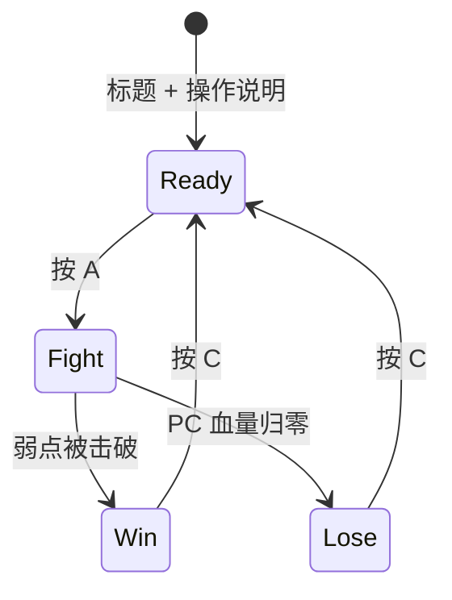

# 巨构游戏：策划

[文档索引](README.md) · [API](api.md) · [分工](workflow.md)

## 一句话

在雾气弥漫的荒原上，玩家用射击和钩锁挑战一头山一样大的巨兽，逐块击碎它身上的护甲和结晶，最后击破弱点。

## 核心循环

- 一局 2–3 分钟。每次开局随机组合 BOSS 部件，并重置血量、位置和计时。
- 屏幕上要始终显示目标提示，例如“击碎护甲”“钩住巨兽”“击破头部结晶”。

## PC（玩家）

| 能力 | 说明 |
| --- | --- |
| 移动 | 摇杆，第三人称 |
| 射击（A） | 射向准星方向。准星用**倾斜（Movement）微调**，摇杆负责大方向 |
| 钩锁（B） | 向准星方向射出钩爪，命中可挂点后被拉过去，挂在 BOSS 身上；再按 B 脱离并下落 |
| 闪避 / 跳跃（摇杆按下） | 在地面上用来躲挥拳和冲击波，有短暂无敌时间 |
| 锁定（按住 C） | 相机对准 BOSS 并自动上仰 |
| 血量 | 离散血格（默认 5 格），受击扣 1 格并有 1 s 无敌 |

### 钩锁（取代攀爬）

**判断：合理，建议采用。** 理由有三：

1. **碰撞全部用几何体。** BOSS 每段骨骼挂 1–3 个球体或胶囊体，地面是高度图。钩锁就是一次射线检测，不需要网格级碰撞。
2. **挂住后的逻辑很简单。** 命中时记录挂点在骨骼局部坐标系里的位置；之后每帧 PC 位置等于该骨骼的世界矩阵乘以这个局部点，PC 自然就跟着 BOSS 的动作移动，不需要物理模拟。
3. **“抖落”机制可以恢复。** PC 挂着时，BOSS 会触发“甩动”动作；在甩动窗口内没有及时按 B 跳开的话，就会被甩下来并受伤。

钩锁的规则：

- **射程**：25 m。准星落在可挂点上时高亮显示（`reticle_flags.hookable`）。
- **飞行**：钩爪飞行约 0.3 s，绳索画成一条 3D 线段；随后 PC 以约 15 m/s 被拉到挂点。
- **挂住时**：
  - 可以射击，近距离伤害 ×2；
  - **弱点（头部结晶）只有挂在 BOSS 身上时才能打中**。这就是钩锁存在的意义。
- **脱离**：再按 B，或被甩落。脱离后按重力下落，落地没有伤害，降低挫败感。

## BOSS

- **主体**：先做**巨型麋鹿**（P0），**巨型猩猩**作为加分项（P2）。
- **结构**：由 ≤16 段刚体骨骼组成的层级结构，用关键帧做动画，不做蒙皮。
- **部件（击破部件）**：挂在部件槽上，每个槽开局时随机选一个变体（护甲 / 结晶 / 空）。每个部件有自己的血量；击破后不再绘制，并闪烁提示。
- **阶段**：
  1. 击碎腿部护甲 → BOSS 跪地（这时更容易钩住背部）。
  2. 击碎背部和颈部结晶 → 暴露头部弱点。
  3. 挂在 BOSS 身上击破头部弱点 → 胜利。

| 动作 | 来源 | 前摇 | 应对 |
| --- | --- | --- | --- |
| 挥拳 / 鹿角横扫 | 主体 | 约 1 s，抬起肢体 | 闪避 |
| 踩地冲击波 | 主体 | 约 0.8 s，前腿抬起 | 在波到达时跳起 |
| 甩动 | 主体，PC 挂上后触发 | 约 0.6 s，全身绷紧 | 按 B 脱离 |
| 结晶射击（P2） | 部件 | 结晶发光 | 移动躲开 |

## 画面（旧时代简化版）

- **雾**：根据 z-buffer 做逐像素深度雾，用查找表把颜色分 16 级混向雾色（N64 / PS1 风格）。雾的最远距离同时作为绘制距离。
- **天空**：从地平线到天顶的两色渐变。
- **地面**：高度图地形网格（默认 17×17，格宽 8 m）。草地用两种顶点色按噪声交错来表现，**不画草叶**。
- **岩石**：基础低多边形网格，按随机种子缩放、旋转后散布在地图上。
- **BOSS / PC**：低多边形平面着色，部件用高亮色以便识别。
- **UI**：血格、BOSS 血条、准星、目标提示和结算画面，都直接画进 3D 帧里。

## 操作表

| 输入 | 地面 | 挂在 BOSS 上 |
| --- | --- | --- |
| 摇杆 | 移动 | 绕挂点微调视角 |
| 倾斜 | 准星微调 | 准星微调 |
| A | 射击 | 射击（×2） |
| B | 发射钩锁 | 脱离 |
| 摇杆按下 | 闪避 / 跳跃 | — |
| C | 按住锁定 / 结算画面中重开 | 同左 |

## 范围优先级

| 级别 | 内容 |
| --- | --- |
| **P0** 完整一局 | 地形 + 雾 + 天空；麋鹿 + 4–6 个部件；射击 + 倾斜瞄准；挥拳 + 闪避；离散血格；Ready → Fight → Win/Lose → 重开 |
| **P1** 核心特色 | 钩锁 + 挂住 + 甩动；跪地阶段 + 头部弱点；冲击波 + 跳跃；岩石；部件随机组合 |
| **P2** 加分 | 猩猩主体；结晶射击；近景草丛面片；音效 |

## 资产清单（模型制作不在工程分工内）

| 资产 | 需求 | 占位方案 |
| --- | --- | --- |
| 麋鹿骨骼段 | ≤16 段，总计 ≤600 面 | 由工具生成的方块和胶囊体 |
| 部件变体 | 护甲、结晶各 2–3 种，每个 ≤40 面 | 生成的八面体 |
| PC | ≤60 面 | 生成的方块 |
| 岩石 | 2–3 种，每种 ≤30 面 | 生成的二十面体 |
| 弹丸 / 钩爪 / 火花 | 每种 ≤12 面 | 生成的四面体 |

资产格式和导入流程见 [api.md §5](api.md#5-共享数据格式)。
