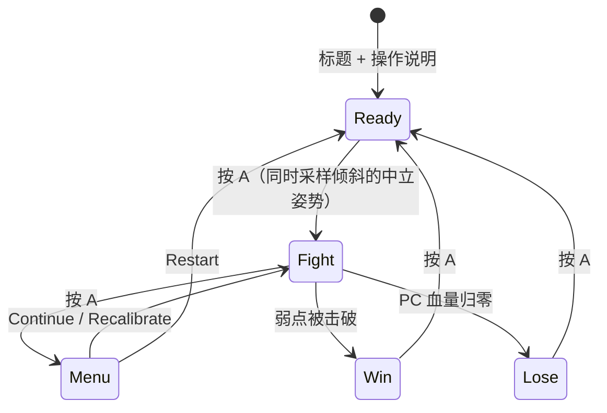

# 巨构游戏：策划

[文档索引](README.md) · [API](api.md) · [分工](workflow.md)

## 一句话

在雾气弥漫的荒原上，玩家用射击和钩锁挑战一头山一样大的巨兽，逐块击碎它身上的护甲和结晶，最后击破弱点。

## 核心循环

- 一局 2–3 分钟。每次开局随机组合 BOSS 部件，并重置血量、位置和计时。
- 屏幕上要始终显示目标提示，例如“击碎护甲”“钩住巨兽”“击破头部结晶”。

## PC（玩家）

| 能力 | 说明 |
| --- | --- |
| 移动 | **骑马**：摇杆左右转向（100°/s），**镜头跟着一起转**；摇杆上下前进（6 m/s）/ 后退（35%）。松开摇杆时马站立。钩锁时离鞍、马淡出，落地前马淡入，直接落回马鞍（[art.md §2](art.md#pc骑手--马)） |
| 视角 | 摇杆转向带动镜头，**倾斜掌机**在此基础上再转视角（速率控制：倾斜越大转得越快，回到中立就停）。骑行中 0.8 s 不倾斜，镜头慢慢回到马的正后方。射击不会让马转向。中立姿势在 Ready 画面按 A 时采样，菜单里可以 Recalibrate。参数都在 `python/tilt_config.py` |
| 射击（B） | 即时命中，射向准星（屏幕中央）；按住按 0.25 s 冷却连发；子弹是 0.2–0.6 s 的弹道光效。准星 4° 内有部件或挂点时自动吸附 |
| 钩锁（C） | 向准星方向射出钩爪，命中可挂点后被拉过去，挂在 BOSS 身上；再按 C 脱离并下落 |
| 菜单（A） | 暂停并弹出菜单：Continue / Restart / Recalibrate；摇杆上下选择，A 确认 |
| 血量 | 离散血格（默认 5 格），受击扣 1 格并有 1 s 无敌 |

**没有闪避和跳跃**：所有攻击都有明显前摇，靠走位躲开。BOSS 不在屏幕内且倾斜在死区内超过 1.5 s 时，视角慢慢转回对准 BOSS。

### 钩锁（取代攀爬）

**判断：合理，建议采用。** 理由有三：

1. **碰撞全部用几何体。** BOSS 每段骨骼挂 1–3 个球体或胶囊体，地面是高度图。钩锁就是一次射线检测，不需要网格级碰撞。
2. **挂住后的逻辑很简单。** 命中时记录挂点在骨骼局部坐标系里的位置；之后每帧 PC 位置等于该骨骼的世界矩阵乘以这个局部点，PC 自然就跟着 BOSS 的动作移动，不需要物理模拟。
3. **“抖落”机制可以恢复。** PC 挂着时，BOSS 会触发“甩动”动作；在甩动窗口内没有及时按 C 跳开的话，就会被甩下来并受伤。

钩锁的规则：

- **射程**：25 m。准星落在可挂点上时高亮显示（`reticle_flags.hookable`）。
- **飞行**：钩爪飞行约 0.3 s，绳索画成一条 3D 线段；随后 PC 以约 15 m/s 被拉到挂点。
- **挂住时**：
  - 可以射击，近距离伤害 ×2；
  - **弱点（头部结晶）只有挂在 BOSS 身上时才能打中**。这就是钩锁存在的意义。
- **脱离**：再按 C，或被甩落。脱离后按重力下落，落地没有伤害，降低挫败感。

## BOSS

- **主体**：先做**巨型麋鹿**（P0），**巨型猩猩**作为加分项（P2）。
- **结构**：由 ≤16 段刚体骨骼组成的层级结构，用关键帧做动画，不做蒙皮。
- **部件（击破部件）**：每局装 **2 个随机腿甲 + 背部 + 头部**（石盖和弱点），变体随机，其余槽位为空。每个部件有自己的血量；受击闪白，击破后不再绘制并冒碎片。
- **阶段**（2026-10-24 定稿，当前实现）：
  1. 击碎两个腿甲 → BOSS 跪地，之后**一直跪着、不再攻击**。
  2. 腿甲和背部都击碎 → 头顶石盖碎裂，暴露头部弱点。背部朝上，基本要用钩锁挂上去打。
  3. 挂在 BOSS 身上击破头部弱点（只有挂住时才能伤到）→ 胜利。
- **行为**：平时站在场地中央**不转身**。人物在 14 m 以内时，每隔 5–8 s 发起一次攻击：先以 25°/s 慢慢转向人物，然后踢击或鹿角横扫；打中扣 1 格血，挂在 BOSS 身上时不会被打到。血量归零即失败。

| 动作 | 来源 | 前摇 | 应对 |
| --- | --- | --- | --- |
| 踢击（`punch_r`）/ 鹿角横扫（`sweep`）✅ | 主体 | 先慢慢转向人物，再约 1 s 抬起肢体 | 趁它转身时绕开，离开正前方的打击范围 |
| 踩地冲击波（未做） | 主体 | 约 0.8 s，前腿抬起 | 冲击波扩散到最大半径（约 14 m）为止，站在圈外 |
| 甩动（未做） | 主体，PC 挂上后触发 | 约 0.6 s，全身绷紧 | 按 C 脱离 |
| 结晶射击（P2） | 部件 | 结晶发光 | 移动躲开 |

## 画面（旧时代简化版）

整体风格致敬《旺达与巨像》：空旷、褪色、渺小对巨大，巨像是"长着毛的古代废墟"。完整规范见 [art.md](art.md)。

- **雾**：根据 z-buffer 做逐像素深度雾，用查找表把颜色分 16 级混向雾色（N64 / PS1 风格）。雾的最远距离同时作为绘制距离。
- **天空**：从地平线到天顶的两色渐变。
- **地面**：高度图地形网格（默认 17×17，格宽 16 m，覆盖 256 m 见方，雾的最远距离 120 m 内看不到地图边缘）。草地用两种顶点色按噪声交错来表现，**不画草叶**。
- **岩石**：基础低多边形网格（含断柱、拱门残片），按随机种子缩放、旋转后散布在地图上。
- **BOSS / PC**：低多边形平面着色。材质即玩法：浅色毛丛可挂钩，石板是护甲，发光符印是结晶和弱点。
- **调色**：32 色调色板 + 可配置的调色参数（Look），可整局替换；P1 增加逐像素滤镜（色阶、抖动）。
- **UI**：血格、BOSS 血条、准星、目标提示和结算画面，都直接画进 3D 帧里。只用英文和像素字体。

## 操作表

以这张表为准（2026-10-24 讨论定稿）。

| 输入 | Ready 画面 | 地面 | 挂在 BOSS 上（P1） | 菜单 | 结算画面 |
| --- | --- | --- | --- | --- | --- |
| 摇杆 | — | 左右转向（带动镜头）、上下前进 / 后退 | — | 上下选择 | — |
| 倾斜 | — | 转动视角 | 转动视角 | — | — |
| A | 开始（采样中立姿势） | 打开菜单 | 打开菜单 | 确认 | 重开 |
| B | — | 射击 | 射击（×2） | — | — |
| C | — | 发射钩锁 | 脱离 | — | — |
| 摇杆按下 | — | 保留 | — | — | — |

## 范围优先级

| 级别 | 内容 |
| --- | --- |
| **P0** 完整一局 | 地形 + 雾 + 天空；麋鹿 + 4–6 个部件；射击 + 倾斜视角；挥拳（走位躲）；离散血格；Ready → Fight ⇄ 菜单 → Win/Lose → 重开 |
| **P1** 核心特色 | 钩锁 + 挂住 + 甩动；跪地阶段 + 头部弱点；冲击波（站在圈外躲）；岩石；部件随机组合 |
| **P2** 加分 | 猩猩主体；结晶射击；近景草丛面片；音效 |

## 资产清单（模型制作不在工程分工内）

| 资产 | 需求 | 占位方案 |
| --- | --- | --- |
| 麋鹿骨骼段 | ≤16 段，总计 ≤600 面 | 由工具生成的方块和胶囊体 |
| 部件变体 | 护甲、结晶各 2–3 种，每个 ≤40 面 | 生成的八面体 |
| PC：马 + 骑手 | 马 ≤150 面、骑手 ≤90 面，两个 rig | `tool/` 程序化生成（已交付） |
| 岩石 | 2–3 种，每种 ≤30 面 | 生成的二十面体 |
| 头部弱点符印 | ≤20 面，暴露前有石板盖住（盖板算一个部件） | 生成的八面体 |
| 弹丸 / BOSS 弹 / 钩爪 / 火花 | 每种 ≤12 面 | 生成的四面体 |
| 冲击波尘环 | ≤32 面 | 生成的圆环 |
| 像素字体 | 5×7 和 8×8 各一套，开源许可 | Adafruit GFX 自带字体 |
| Look 预设 | `forbidden_plain`（默认）、`dusk`、`storm`、`ps1` | 只用默认调色板 |

资产格式和导入流程见 [api.md §5](api.md#5-共享数据格式)，建模规范见 [art.md §8](art.md#8-建模规范)。
