# 任务卡与执行流程

[文档索引](README.md) · [分工](workflow.md) · [API](api.md) · [策划](plan.md)

本文件把 [workflow.md](workflow.md) 的完整范围（P0 + P1 + P2，不删减）拆成任务卡，供 **Claude Code 执行、人负责验证**。分工、文件归属、依赖和降级方案都以 workflow.md 为准，本文件补充执行方式。

## 1. 工作模式

| | 人 A（渲染端） | 人 B（玩法端） |
| --- | --- | --- |
| 驱动 | Claude 会话 A，在 `render/*` 分支 | Claude 会话 B，在 `game/*` 分支 |
| Claude 负责 | 写代码、编译、刷板、读串口日志、自检 | 写代码、单元测试、生成工具、读 Python 日志、自检 |
| 人负责 | **看 TFT 画面**、判断性能和画质、决定是否走降级方案 | **试玩**、判断手感、调参数、审核生成的数据 |
| 共同负责 | 同意 `api.md` 修改；完成每次联调的验收 | |

Claude 看不到屏幕，所以每张卡分两栏写验收标准：

- **Claude 自检**：Claude 能自己运行并读到结果，例如 `pytest`、编译输出、`make logs` 和串口里打印的计时。
- **人工确认**：必须有人看屏幕或拿着手柄。Claude 完成自检后会停下来，向人说明需要看什么。

### 并行规则

- **两个会话各用一个 git worktree**，互不干扰：
  ```sh
  git worktree add ../hackout-render -b render/a2-tft8080
  git worktree add ../hackout-game   -b game/b1-g3d
  ```
- **只有一台掌机，刷板必须加锁。** 两个会话都用下面的命令，不要直接运行 `make flash`：
  ```sh
  flock /tmp/uno-q-board.lock make flash
  ```
  同一时间板子上只能运行一个 App Lab 应用，后刷的会覆盖先刷的。刷完后，通知另一方“板子上现在是哪个分支”。
- **读日志**：`make logs` 和 `make monitor` 用的是 `adb shell -t`，在没有终端的环境里读不到输出。Claude 要用非交互方式读取：`adb -d shell -T 'TMPDIR=/tmp arduino-app-cli app logs "$HOME/ArduinoApps/uno-q-arcade-cli" 2>&1 | tail -30'`。
- **阶段 1 期间板子优先给 A**，B 的工作在电脑上完成（`pytest`、`tools/sim.py`）。从联调开始按需轮流使用。

### 给 Claude 的指令模板

```text
执行 arcade/docs/tasks.md 的 <卡号> 卡。
先读：api.md <相关章节>、research.md <相关章节>、本卡依赖的已有代码。
只改本卡“文件”列出的路径；如果需要修改 api.md，先停下来问我。
完成后运行本卡的“Claude 自检”，把结果贴出来，并告诉我“人工确认”要看什么。
不要合并进 main。
```

## 2. 时间线与检查点

检查点用来**暴露风险**，不是砍功能。不通过时按 [workflow.md §5](workflow.md#5-降级方案) 换实现方式，功能范围不变。

```mermaid
gantt
    dateFormat HH:mm
    axisFormat T+%H:%M
    section 共同
    阶段 0 契约        :c0, 00:00, 45m
    I1                 :milestone, 03:30, 0m
    I2 · P0            :milestone, 06:30, 0m
    I3 · P1            :milestone, 09:00, 0m
    P2 + 收尾          :crit, 09:00, 180m
    section A 渲染端
    A1–A4              :a, 00:45, 165m
    A5–A8              :a2, 03:30, 180m
    A9–A11             :a3, 06:30, 150m
    section B 玩法端
    B1–B4              :b, 00:45, 165m
    B5–B8              :b2, 03:30, 180m
    B9–B11             :b3, 06:30, 150m
```



| 检查点 | 时间 | 通过标准 | 不通过 |
| --- | --- | --- | --- |
| **G1** 推屏 | T+1:45 | A2 全屏 < 50 ms | 改用 `gpio_port_set_masked_raw`，或降到 160×120 渲染 |
| **G2** TGX | T+2:45 | A3 ≥ 15 fps，LLEXT 内存放得下 | 改为 static link，或减小分块高度；仍不行就用 §5 的 2D 保底并行推进 |
| **I1** | T+3:30 | 运行 10 分钟不卡；`seq_ack` 连续递增；输入延迟 < 150 ms | 先修通信，暂停新功能 |
| **I2** P0 | T+6:30 | 新玩家看得懂目标，能打完一局并重开 | 先修 P0，暂停 P1 |
| **I3** P1 | T+9:00 | 钩锁完整一局 | 钩锁改为自动吸附（workflow §5） |
| **代码冻结** | T+11:00 | — | 之后只合并 bug 修复 |

## 3. 阶段 0：契约（两人 + 一个 Claude 会话，T+0:00–0:45）

| 步骤 | 谁 | 内容 |
| --- | --- | --- |
| 0.1 | 两人 | 逐字段过一遍 api.md §2–§5，冻结 v1 |
| 0.2 | Claude | 统一 core 版本：`sketch/sketch.yaml` 锁定为板子上的 `arduino:zephyr 1.0.0`（research §2）；在 README 的 Board software 小节同步版本号 |
| 0.3 | Claude | 建目录：`sketch/gen/`、`python/gen/`、`tools/`、`tests/{golden,cpp}/`、`assets/{rigs,meshes}/` |
| 0.4 | Claude 起草，两人审核 | `assets/rigs/moose.json`：6 段骨骼、4 个槽位、`idle` 和 `punch_r` 动画（带 `hit` 事件）；`assets/meshes.json` 的 0–5 号网格 |
| 0.5 ✅ | Claude | 本地工具：仓库根目录的 `.venv`（Python 3.14，含 pytest、pygame-ce）；arduino-cli 装在 `~/.local/bin`；`make build` 能在电脑上编译通过，Flash 用 17%，RAM 用 55 KB / 256 KB |
| 0.6 ✅ | Claude | 板子自检：`make flash` 成功；三个 Modulino 均已连接（`connected = 7`）；`arcade_read_inputs` 往返 16–108 ms（与 starter 的绘制循环同时运行时测得） |

## 4. 任务卡

### 阶段 1：各自打通（T+0:45–3:30）

| 卡 | 文件 | 内容 | Claude 自检 | 人工确认 |
| --- | --- | --- | --- | --- |
| **A1** 基准（30 min） | 临时 sketch，不合并 | DIYables `fillScreen` 耗时；Bridge 往返时间（192 B bin 参数，100 次平均）；**`MsgPack::bin_t` 能否作为返回值** | 串口打印三项数据，填进 research.md §5，把“估算”改成“实测” | — |
| **A2** `tft8080`（60 min） | `sketch/tft8080.h/.cpp` | 用 DIYables `begin()` 初始化，之后用 BSRR 写像素，每字节 3 次寄存器写（research §4）；实现 `window / pushPixels / pushRow2x / fill` | 串口打印全屏 `fill` 耗时 < 50 ms（**G1**） | 纯色、渐变和条纹画面没有错位或偏色 |
| **A3** TGX 分块（60 min） | `sketch.yaml`、`sketch/render.*` | 加入 TGX 1.1.4；240×16 分块渲染旋转立方体，`pushRow2x` 推屏；实现 `G3D_DEMO=1` 演示模式的框架 | `make build` 通过；串口打印 `render_ms`、`push_ms` 和 fps（**G2**）；记录 LLEXT 堆用量 | 立方体正确、不撕裂 |
| **A4** rpc + scene（45 min） | `sketch/rpc.*`、`sketch/scene.*`、`sketch.ino` | 注册 api §2 全部方法，保留 `arcade_*`；`scene_begin/chunk/commit` 包括 CRC 校验和地形网格构建；`loop()` 从 `takePending` 取最新帧来渲染 | 运行 `tools/replay.py` 发送 golden 包，Python 日志里 `hello`、`commit` 都成功，`seq_ack` 正确回显 | 地形和物体位置正确 |
| **B1** `g3d.py`（45 min） | `python/g3d.py`、`tests/test_g3d.py` | 实现 `pack_scene`（hdr + chunks + CRC-16/CCITT-FALSE）、`pack_frame`、`unpack_input`（同时兼容 bytes 和 hex str），以及 `G3D` 连接层（超时、重试、重新加载场景） | `pytest tests/` 通过；生成 `tests/golden/protocol.json`（每种包 3 个样例） | — |
| **B2** 生成工具（60 min） | `tools/rig_build.py`、`tools/mesh_build.py`、`tools/replay.py` | rig JSON → `sketch/gen/rig_*.h` + `python/gen/rig_*.py` + `tests/golden/rig_*.json`；`--placeholder` 生成占位 OBJ，再用 `tgx_mesh.py` 转成头文件，并生成 `mesh_ids`；`replay.py` 在板子上发送 golden 包 | 生成文件后再生成一次，内容不变；`make build` 能 include 生成的头文件；**T+2:15 前交付给 A** | B 审核骨骼数据 |
| **B3** `sim.py`（45 min） | `tools/sim.py` | 用 pygame 做线框渲染：读 `pack_frame` 输出的帧，按 api 约定还原相机、BOSS 骨骼和物体；键盘模拟摇杆和按键 | 无头模式（`SDL_VIDEODRIVER=dummy`）跑 300 帧不报错 | 能在电脑上走动并看到 BOSS 线框 |
| **B4** 世界、姿态、碰撞（60 min） | `python/world.py`、`rig.py`、`collide.py`、`controls.py` | `make_scene(seed)` 生成高度图和岩石；`terrain_height` 用双线性插值；`rig.pose` 和 `colliders_world`；`ray_cast` 和 `sphere_vs`；`Controls` 做边沿检测 | `pytest` 通过，包括 rig golden 比对（误差 ≤ 1 cm）和射线命中的各种情况 | — |

**I1（T+3:30）**：B 的 `main.py` 发送静态场景和绕圈相机，A 的渲染端负责显示。Claude 在日志里检查 `seq_ack` 连续递增，并统计 `render_ms`、`push_ms` 和 RPC 耗时；人观察 10 分钟，并感受输入延迟。

### 阶段 2：P0 功能（T+3:30–6:30）

| 卡 | 文件 | 内容 | Claude 自检 | 人工确认 |
| --- | --- | --- | --- | --- |
| **A5** rig 绘制 | `sketch/rig.*` | 实现 `pose()`（api §5.1），绘制骨骼网格和槽位部件，处理 `part_alive` 和 `hit_slot` 闪烁 | 在 `tests/cpp/` 用 g++ 编译 `rig.cpp`，与 `tests/golden/rig_*.json` 比对，误差 ≤ 1 cm | idle 和 punch 动作正确 |
| **A6** 雾、天空、草地 | `sketch/render.*` | z-buffer 深度雾配 16 级查找表；天空两色渐变；地形按两种草色交错着色 | `flags.bit1` 开关雾，分别打印两种情况的 `render_ms` | 雾的效果和远处的隐没 |
| **A7** HUD | `sketch/hud.*`、`hud_text.h` | 血格、BOSS 血条、准星、`msg_id` 文案、结算画面；只画在当前分块内 | replay 发送 `game_state` 0–4 共 5 个包，渲染不出错 | 5 种布局清楚可读 |
| **A8** 陀螺仪 | `sketch/rpc.*` | 在 Input 中填入 `gx/gy` | Python 日志中转动掌机时 `gx/gy` 有变化 | — |
| **B5** `Game` | `python/game.py`、`main.py` | Ready → Fight → Win/Lose → 重开；每局重置；控件断开时进入 Paused | 用脚本按顺序输入并断言状态切换正确 | 用 A 开局、C 重开 |
| **B6** `Player` | `python/player.py` | 移动、闪避（带无敌）、射击、倾斜加陀螺仪瞄准、血格 | 单元测试：闪避期间无敌，受击后 1 s 无敌 | 手感 |
| **B7** `Boss` | `python/boss.py` | idle / punch AI；部件血量；`events` 攻击判定；三个阶段（腿甲 → 背颈结晶 → 头部） | 脚本模拟打完一整局 | 前摇看得清、躲得开 |
| **B8** `Camera` | `python/camera.py` | 第三人称跟随；按住 C 锁定 BOSS 并上仰 | 在 sim.py 里检查相机不会穿进地形 | 画面不抖、能找到 BOSS |

**I2（T+6:30）**：完整打一局 P0。人对照评分表自测，Claude 检查日志里有没有异常和丢帧。

### 阶段 3：P1 功能（T+6:30–9:00）

| 卡 | 文件 | 内容 | Claude 自检 | 人工确认 |
| --- | --- | --- | --- | --- |
| **A9** 绳索与钩爪 | `sketch/render.*` | 从 `hand` 挂点到 `anchor` 画 3D 线段，绘制 `hook_head` 物体 | replay 发送 hook 包，渲染不出错 | 绳索跟随钩爪 |
| **A10** 岩石实例化 | `sketch/scene.*`、`render.*` | 处理 kind 2 chunk；岩石按 yaw 和 scale 实例化，y 坐标由 `terrainHeight` 求出 | 用 g++ 比对 `terrainHeight` 与 Python 版结果一致 | 岩石贴在地面上 |
| **A11** 性能收尾 | `sketch/render.*` | 按物体包围球的 Y 范围做分块剔除，减少分块次数 | `render_ms` 比 I2 时更低（打印对比） | 帧率体感 |
| **B9** 钩锁 | `python/player.py`、`collide.py` | 射线只命中 `hookable` 碰撞体；钩爪飞行 0.3 s，以 15 m/s 拉过去；挂点跟随骨骼；按 B 脱离；挂住时伤害 ×2 | 单元测试：BOSS 运动时挂点误差为 0 | 手感 |
| **B10** 甩动、跪地、弱点、冲击波 | `python/boss.py` | 挂住后触发甩动窗口；腿甲全部击破后跪地；头部弱点只有挂住时才能打中；冲击波需要跳跃躲避 | 脚本模拟打完 P1 一局 | 节奏 |
| **B11** 随机组合与难度 | `python/world.py`、`boss.py` | 每局随机部件变体；难度曲线 | 10 个种子生成的局都能打完（脚本） | 难度 |

**I3（T+9:00）**：完整打一局 P1。

### 阶段 4：P2 加分（T+9:00–11:00）

两个会话并行做，每项完成就合并，到时间就停：

| 卡 | 负责 | 内容 |
| --- | --- | --- |
| **P2-1** 猩猩主体 | B 起草 rig JSON，两端联调 | `assets/rigs/gorilla.json` 和对应动画；`rig_id = 2` |
| **P2-2** 结晶射击 | B（`boss_shot` 物体），A（发光效果） | 结晶发光作为前摇，然后发射弹丸 |
| **P2-3** 近景草丛面片 | A | 只在相机附近画面片，并做距离剔除 |
| **P2-4** 音效 | B | 从 MPU 的 ALSA 耳机口播放（research §1），由事件触发 |

## 5. 降级方案

详细内容见 [workflow.md §5](workflow.md#5-降级方案)。补充一条整体保底：

**2D 俯视渲染**：G2 检查点不通过时，由**另一个 Claude 会话**并行写 `sketch/render2d.cpp`，用同一个 Frame 包按 `x, z` 画俯视图。Frame 包里只有世界坐标，所以玩法端完全不用改。3D 那条线继续推进；演示前哪个版本能用就演示哪个。

## 6. Git 流程

- **每张卡一个分支**：`render/<卡号>-<主题>` 或 `game/<卡号>-<主题>`。卡完成后合并，不要攒着。
- **合并进 `main` 之前**：
  1. `git pull --rebase origin main`；
  2. `make build`；
  3. `pytest tests/`；
  4. `flock … make flash` 后能正常启动。
- **评审**：对方的人看一眼 PR（不超过 5 分钟）；涉及 api.md 的改动要两人都确认。
- **生成文件**：`sketch/gen/` 和 `python/gen/` 只能由工具生成，并且和改动它的 `assets/` 一起提交。
- **协议修改**：
  1. 先停下来，两人确认；
  2. 在同一个提交里修改 `api.md`、让 `G3D_VERSION` 加 1，并更新 golden 数据；
  3. 两端在各自分支跟进，**同时合并**。

## 7. 收尾（两人一起，T+11:00–12:00）

- [ ] 找一个没玩过的人试玩，根据反馈调整灵敏度、文字大小和难度。
- [ ] 让 Claude 更新 `arcade/README.md`：启动命令、操作表、校准方法、TFT 控制器设置，以及素材来源。
- [ ] 在 `main` 上打 tag `demo`；执行 `make package`，留一份 App Lab ZIP 备份。
- [ ] 录一段完整一局的演示视频。
