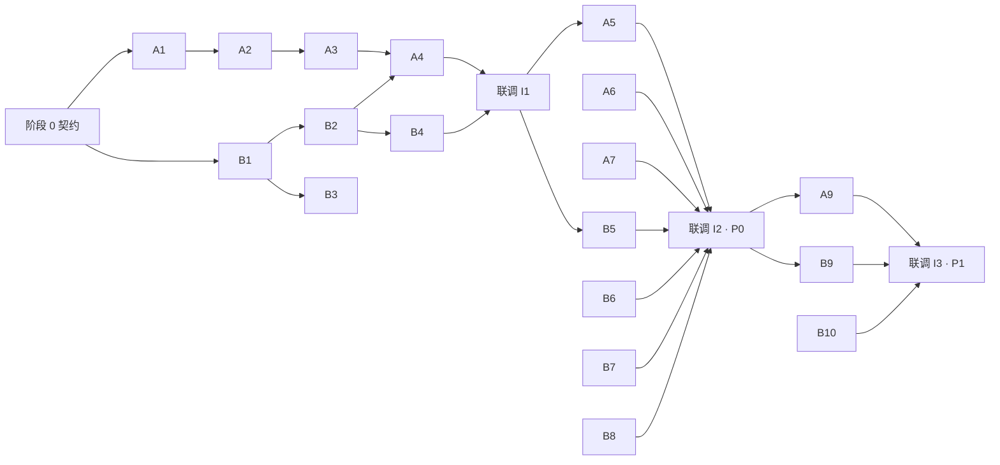

# 双人分工

[文档索引](README.md) · [API](api.md) · [策划](plan.md)

## 1. 角色

| | **A：渲染端**（MCU / C++） | **B：玩法端**（MPU / Python + 工具） |
| --- | --- | --- |
| 负责 | 把 Frame 包画到 TFT 上，并采集输入 | 游戏逻辑、数据工具、协议打包 |
| 主要风险 | 性能（推屏、TGX、LLEXT 内存） | 手感、碰撞、骨骼数据一致性 |
| 不依赖对方时用的替身 | 没有 Python 帧时自动显示的演示画面 | `tests/test_game.py` + `render_preview.sh --snapshots`；`tools/sim.py` 桌面模拟器（计划中） |

模型制作不在分工范围内。在模型交付前，双方都使用 `tools/mesh_build.py --placeholder` 生成的占位模型。

## 2. 文件归属

谁负责就由谁合并；另一方修改需要先在评审里打招呼。

| 路径 | 负责人 |
| --- | --- |
| `sketch/**`（`gen/` 除外） | A |
| `python/**`（`gen/` 除外） | B |
| `tools/**`、`tests/**` | B，其中 `tests/cpp/` 归 A |
| `assets/**` | 美术交付，B 负责导入；程序化生成的资产经 `tool/promote.py` 进入（[art.md §9](art.md#9-资产工作流)） |
| `tool/**` | 本地资产生成与预览，**不提交**（已在 `.gitignore`） |
| `sketch/gen/`、`python/gen/` | 只能由工具生成，**禁止手改** |
| `docs/api.md` | **双方共同维护**，任何修改都要两人同意并递增 `G3D_VERSION` |

分支命名：`render/<主题>`、`game/<主题>`。合并进 `main` 的提交必须能 `make flash` 并正常启动。

## 3. 阶段与任务

### 阶段 0：契约（两人一起，约 1 小时）

- [ ] 逐字段过一遍 `api.md` §2–§5，冻结 v1。
- [ ] 建好目录骨架：`sketch/gen/`、`python/gen/`、`tools/`、`tests/`、`assets/`。
- [x] `assets/rigs/moose.json`：11 段骨骼、8 个槽位、8 个动画，由 `arcade/tool/` 生成（[art.md §9](art.md#9-资产工作流)）。
- [ ] B 先实现 `pack_frame` / `pack_scene`，生成 `tests/golden/protocol.json`（每种包给 3 个样例的十六进制字节）。

### 阶段 1：各自打通（并行）

| A：渲染端 | 验收标准 | B：玩法端 | 验收标准 |
| --- | --- | --- | --- |
| **A1** M0 基准：DIYables 全屏耗时、BSRR 全屏耗时、Bridge 往返时间 | 把数据填进 `research.md` §5 | **B1** `g3d.py` 的打包和解包，通过 golden 测试 | `pytest tests/` 通过 |
| **A2** `tft8080` 快速驱动 | 全屏 < 50 ms，画面无错位 | **B2** `tools/rig_build.py` + `mesh_build.py --placeholder` + `palette.json` / `font_build.py` | 生成两端代码和 golden 姿态数据 |
| **A3** 集成 TGX，分块渲染一个旋转立方体 | ≥ 15 fps，并确认 LLEXT 内存放得下 | **B3** `tools/sim.py`：键盘输入，用 pygame 线框渲染 Frame 包 | 能在电脑上走动并看到 BOSS 线框 |
| **A4** `rpc` + `scene`：接收场景包，构建地形 | 用 `tools/replay.py` 发送 golden 包，显示正确 | **B4** `world.py` / `rig.py` / `collide.py` | 和 golden 姿态比对误差 ≤ 1 cm |

### 阶段 2：第一次联调 I1（必须在阶段 1 结束时完成）

B 的 `main.py` 只发静态场景和绕圈相机，A 的渲染端负责显示。

验收：板上运行 10 分钟不卡死；`seq_ack` 连续递增；输入延迟 < 150 ms。

### 阶段 3：P0 功能（并行）

| A：渲染端 | B：玩法端 |
| --- | --- |
| **A5** `rig.cpp`：姿态计算、槽位绘制、`hit_slot` 闪烁 | **B5** `Game` 状态机（Ready → Fight → Win/Lose → 重开） |
| **A6** 深度雾 LUT + 天空渐变 + 地形双色草地 + 调色板渲染与调色模式 1 | **B6** `Player`：移动、闪避、射击、倾斜瞄准 |
| **A7** HUD（像素字体）：血格、BOSS 血条、准星、`msg_id` 文案、结算画面 | **B7** `Boss`：idle / punch，部件血量，`events` 攻击判定 |
| **A8** Input 增加陀螺仪 `gx/gy` | **B8** `Camera`：第三人称 + C 键锁定 |

**联调 I2**：完整打一局 P0。按评分表自测：新玩家能否看懂目标、打完一局并重开。

### 阶段 4：P1 功能

| A | B |
| --- | --- |
| **A9** 绳索 3D 线段、钩爪物体 | **B9** 钩锁：射线检测、飞行、挂点跟随骨骼、脱离 |
| **A10** 岩石实例化 | **B10** 甩动、跪地阶段、头部弱点、冲击波 |
| **A11** 性能收尾：剔除、减少分块次数，`render_ms` 达标；预算允许时做调色模式 2 | **B11** 部件随机组合、难度曲线、Look 预设 |

**联调 I3**：完整一局 P1。

### 阶段 5：收尾（两人一起）

- 让没玩过的人试玩，据此调整灵敏度、文字大小和难度。
- 按评分表的 “Explanation and reproducibility” 一项补齐文档：启动命令、操作表、校准方法、素材来源。
- 录制演示视频作为备份。

## 4. 依赖关系

唯一的强依赖是 **B2 → A4/A5**：A 需要用生成的骨骼头文件。所以 B2 要最先完成；在它完成之前，A 先用 TGX 自带的示例网格开发。

## 5. 降级方案

| 风险 | 触发条件 | 降级办法 | 负责人 |
| --- | --- | --- | --- |
| BSRR 快速路径不可用（寄存器访问受限或时序问题） | A1/A2 结果不达标 | 改用 Zephyr 的 `gpio_port_set_masked_raw`；仍然太慢就降到 160×120 渲染 | A |
| TGX 放不进 LLEXT 的 256 KB | A3 | 改用 static link 模式，或减小分块高度，或只链接需要的着色器 | A |
| Bridge 往返 > 40 ms | A1 | Python 改为 10 Hz 发包；MCU 端按上一帧的速度外推相机和 BOSS 的 phase | A + B |
| 帧率 < 10 fps | A3/A11 | 线框风格（`flags.bit0`）作为保底演示；减少地形顶点数 | A |
| 骨骼姿态两端不一致 | B4 golden 测试失败 | 以 Python 版为准修正 C++ | A + B |
| 钩锁手感差 | I3 | 改为自动吸附到最近的可挂点 | B |

## 6. 同步节奏

- **每次开始干活前（5 分钟）**：各自说上次做了什么、这次做什么、卡在哪里，并检查 `api.md` 有没有待处理的修改。
- **联调时**：A 负责板子和 `make monitor`，B 负责 `make logs`，问题记在 `docs/issues.md`。
- **协议修改流程**：提 PR 改 `api.md` → 两人确认 → 同步修改两端并更新 golden 数据 → `G3D_VERSION` 加 1。
